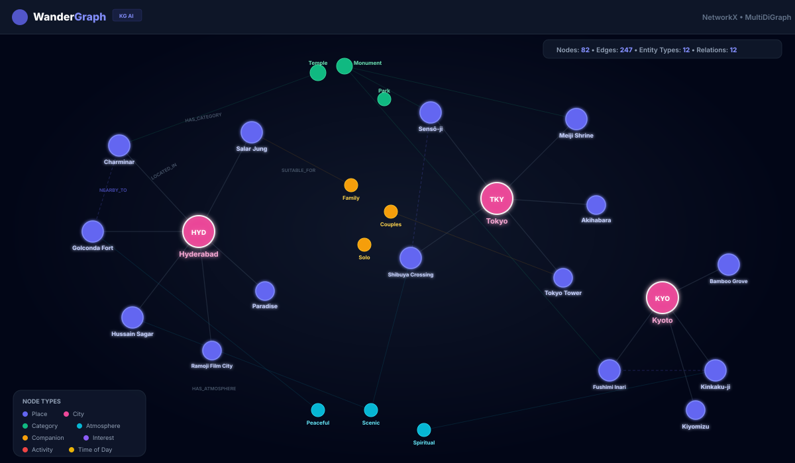
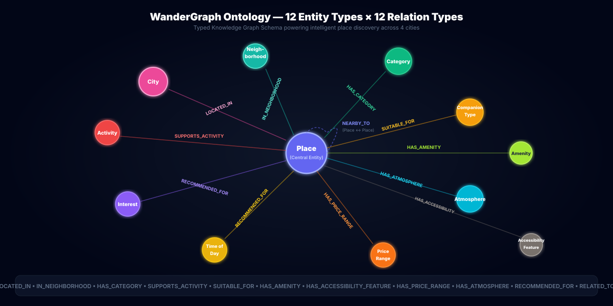
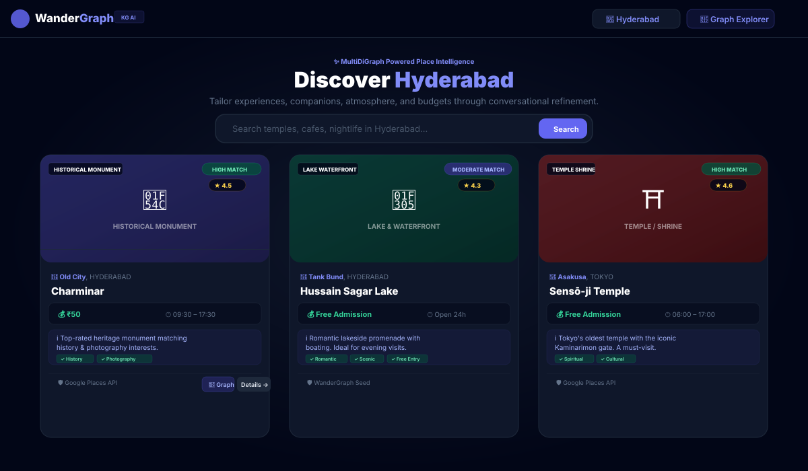

# WanderGraph 🧭

> **Intelligent, interactive, knowledge-graph-powered place-discovery and AI itinerary recommendation platform.**

WanderGraph helps people discover places, activities, experiences, and destinations based on their progressive conversational preferences, budget, atmosphere, and intended companions across **Hyderabad**, **Bengaluru**, **Tokyo**, and **Kyoto**.


---

## 📸 Demo Screenshots

### Knowledge Graph — Multi-City MultiDiGraph Visualization
> Interactive Cytoscape.js canvas with 12 typed entity nodes, semantic directed edges, and verified data provenance across Hyderabad, Bengaluru, Tokyo, and Kyoto.



### Ontology Schema — 12 Entity Types × 12 Relation Types
> The typed knowledge graph schema powering intelligent place discovery — Place nodes connect to City, Neighborhood, Category, Activity, Interest, CompanionType, Atmosphere, PriceRange, TimeOfDay, Amenity, and AccessibilityFeature via directed semantic relationships.



### Place Discovery Engine — Scored Recommendations with Provenance
> Intelligently scored place cards with match confidence, local currency pricing (₹/¥), opening hours, explainable recommendation reasons, and data provenance tracking.



---

## 🎮 Live Interactive Demos

**No backend required** — all demos run entirely in-browser with embedded mock data.

| Demo | Description | Open |
|------|-------------|------|
| 🔗 **Knowledge Graph Explorer** | Interactive Cytoscape.js graph with CoSE/concentric/tree/circle layouts, node search, inspector panel, city filtering, and graph statistics | [`demo/knowledge-graph.html`](demo/knowledge-graph.html) |
| 🗺️ **Place Discovery Engine** | Browse scored recommendations across 4 cities with category filters, match confidence badges, price estimates, and provenance tracking | [`demo/place-discovery.html`](demo/place-discovery.html) |
| 🤖 **AI Itinerary Planner** | Conversational trip planner with structured timeline cards, cost estimates, replacement options, and transit feasibility notes | [`demo/itinerary-planner.html`](demo/itinerary-planner.html) |
| 📋 **Demo Hub** | Landing page linking all demos with tech stack overview | [`demo/index.html`](demo/index.html) |

> **Tip:** Open any `demo/*.html` file directly in your browser — no `npm install` or server needed!

---

## Key Features

1. **Floating AI Itinerary Concierge (Google Gemini 3.5 Flash-Lite)**:
   - Interactive sliding chat drawer with multi-turn trip planning.
   - Tailored recommendations considering budget (e.g., "under ₹1,200 for two"), companion dynamics, and timing.
   - Structured visual timeline cards with scheduled time slots, durations, estimated spend, and one-click stop replacements.

2. **Dual Image Pipeline (100% Photo Coverage)**:
   - Real-world Google Places API (New) Photos with server-side proxy protecting API keys.
   - Real-time **Wikimedia Commons API** resolution for authentic landmark photos (*Charminar, Golconda Fort, Kinkaku-ji, Fushimi Inari, Cubbon Park, Tokyo Tower*).
   - Curated high-aesthetic Unsplash venue photography for neighborhood bistros and cafes.

3. **Multi-City Knowledge Graph (NetworkX MultiDiGraph)**:
   - 12 typed entities: `Place`, `City`, `Neighborhood`, `Category`, `Activity`, `Interest`, `CompanionType`, `Atmosphere`, `PriceRange`, `TimeOfDay`, `Amenity`, `AccessibilityFeature`.
   - Directed semantic relationships (`LOCATED_IN`, `IN_NEIGHBORHOOD`, `HAS_CATEGORY`, `SUITABLE_FOR`, `HAS_ATMOSPHERE`, `NEARBY_TO`, etc.).
   - Interactive canvas visualization using **Cytoscape.js** with CoSE, concentric, breadthfirst, and circular layouts, plus a Node Inspector drawer.

4. **Dynamic Results & Multi-Page Pagination**:
   - Zero arbitrary 12-result ceiling.
   - Google Places API `pageToken` / `nextPageToken` progressive loading with automatic Place ID deduplication.

5. **Accurate Local Currency Estimates (INR ₹ & JPY ¥)**:
   - Real currency formatting replacing generic dollar signs.
   - Verified official admission fees for major monuments and landmarks.
   - Transparent handling of unrecorded prices with methodology notes.

6. **Typo-Tolerant & Locality-Specific Search**:
   - Levenshtein fuzzy spelling correction (`hydrabad` → `Hyderabad`, `kioto` → `Kyoto`).
   - Micro-neighborhood extraction across all 4 cities (`Indiranagar`, `Banjara Hills`, `Gion`, `Shinjuku`).
   - Dynamic editable **Interpretation Banner** with one-click adjustments.

---

## Supported Cities

- 🇮🇳 **Hyderabad, India**: Nizami monuments, lakeside promenades, tech corridors, and historic bazaars.
- 🇮🇳 **Bengaluru, India**: Botanical gardens, craft brewpubs, tech parks, and heritage palaces.
- 🇯🇵 **Tokyo, Japan**: Historic Shinto shrines, neon avenues, shopping districts, and serene gardens.
- 🇯🇵 **Kyoto, Japan**: UNESCO World Heritage temples, bamboo groves, and traditional tea houses.

---

## Knowledge Graph Architecture

```
┌─────────────────────────────────────────────────────────────────┐
│                    WanderGraph MultiDiGraph                      │
│                                                                 │
│   ┌──────┐    LOCATED_IN    ┌──────┐    IN_NEIGHBORHOOD         │
│   │ Place │───────────────▶│ City  │◀─────────────────┐        │
│   └──┬───┘                 └──────┘              ┌────┴─────┐  │
│      │                                           │Neighborhood│  │
│      ├──── HAS_CATEGORY ────▶ [Category]         └──────────┘  │
│      ├──── SUITABLE_FOR ────▶ [CompanionType]                   │
│      ├──── HAS_ATMOSPHERE ──▶ [Atmosphere]                      │
│      ├──── HAS_PRICE_RANGE ─▶ [PriceRange]                     │
│      ├──── RECOMMENDED_FOR ─▶ [TimeOfDay] [Interest]            │
│      ├──── SUPPORTS_ACTIVITY▶ [Activity]                        │
│      ├──── HAS_AMENITY ─────▶ [Amenity]                         │
│      ├──── HAS_ACCESSIBILITY▶ [AccessibilityFeature]            │
│      └──── NEARBY_TO ◀─────▶ [Place]  (≤4km, Haversine)        │
│                                                                 │
│   12 Entity Types  ×  12 Relation Types  ×  4 Cities            │
└─────────────────────────────────────────────────────────────────┘
```

---

## Local Development

### 1. Backend Setup
```bash
cd backend
python -m pip install -r requirements.txt
python -m uvicorn app.main:app --host 127.0.0.1 --port 8000 --reload
```
API runs on `http://127.0.0.1:8000` (Swagger docs at `/docs`).

### 2. Frontend Setup
```bash
cd frontend
npm install
npm run dev
```
Open `http://localhost:5173` in your browser.

### 3. Environment Variables
Copy `.env.example` to `backend/.env`:
```env
GOOGLE_MAPS_API_KEY=your_google_places_api_key_here
GEMINI_API_KEY=your_gemini_api_key_here
ENVIRONMENT=development
HOST=127.0.0.1
PORT=8000
```

---

## Deploy to Vercel

WanderGraph is pre-configured with a root `vercel.json` for full-stack deployment (Vite React frontend + FastAPI Python Serverless Function in `/api`).

### Option 1: Via Vercel Web Dashboard (Recommended)
1. Push your code to a new GitHub repository.
2. Go to [vercel.com/new](https://vercel.com/new) and import your repository.
3. In **Project Settings**:
   - **Framework Preset**: Other (or Vite)
   - **Root Directory**: `.` (leave as root)
   - **Build Command**: `cd frontend && npm install && npm run build`
   - **Output Directory**: `frontend/dist`
4. In **Environment Variables**, add:
   - `GOOGLE_MAPS_API_KEY`: Your Google Places API key
   - `GEMINI_API_KEY`: Your Google Gemini API key
5. Click **Deploy**!

### Option 2: Via Vercel CLI
```bash
npm install -g vercel
vercel
```

---

## Running Tests

### Backend Unit Tests (Pytest)
```bash
cd backend
python -m pytest -v
```
*24 tests passing across 10 modules.*

### Frontend Tests (Vitest)
```bash
cd frontend
npm run test
```
*7 tests passing across 5 test suites.*

---

## Project Structure

```
wandergraph/
├── demo/                          # 🎮 Self-contained interactive demos
│   ├── index.html                 #    Demo hub landing page
│   ├── knowledge-graph.html       #    Interactive Cytoscape.js graph explorer
│   ├── place-discovery.html       #    Place cards & search UI demo
│   └── itinerary-planner.html     #    AI itinerary chat + timeline demo
├── docs/
│   ├── demo-screenshots/          # 📸 Knowledge graph visualization SVGs
│   │   ├── knowledge-graph-overview.svg
│   │   ├── ontology-schema.svg
│   │   └── place-discovery-cards.svg
│   ├── figures/                   #    Architecture & metrics diagrams
│   ├── api.md
│   ├── architecture.md
│   ├── data_policy.md
│   ├── data_sources.md
│   └── development.md
├── backend/
│   ├── app/
│   │   ├── api/                   #    FastAPI routes & Pydantic schemas
│   │   ├── data/                  #    Cities, categories, seed places JSON
│   │   ├── graph/                 #    NetworkX MultiDiGraph builder & schema
│   │   ├── services/              #    Places, recommendation, itinerary, price
│   │   └── utils/                 #    Logging configuration
│   └── tests/                     #    24 Pytest unit tests
├── frontend/
│   ├── src/
│   │   ├── components/            #    React components (13 modules)
│   │   ├── services/              #    API client with proxy URL builder
│   │   ├── styles/                #    Tailwind CSS entry point
│   │   └── types/                 #    TypeScript interfaces & types
│   └── tests/                     #    7 Vitest unit tests
├── api/                           #    Vercel serverless function entry
├── scripts/                       #    Data generation & inspection scripts
├── docker-compose.yml
├── vercel.json
└── README.md
```

---

## Documentation

- [Architecture Design](docs/architecture.md)
- [Data Sources & Provenance](docs/data_sources.md)
- [Google Maps Platform Compliance & Data Policy](docs/data_policy.md)
- [API Specification](docs/api.md)
- [Developer Guide & Quota Tips](docs/development.md)

---

## License

MIT License © 2026 WanderGraph Contributors.
